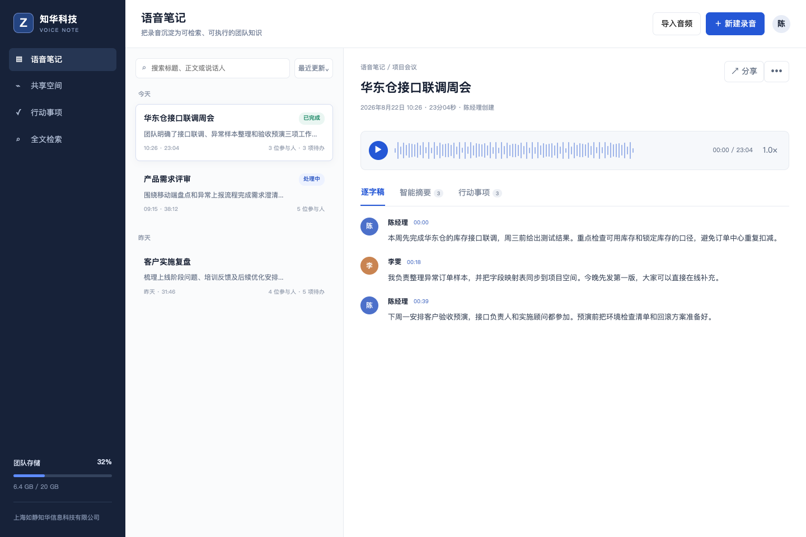
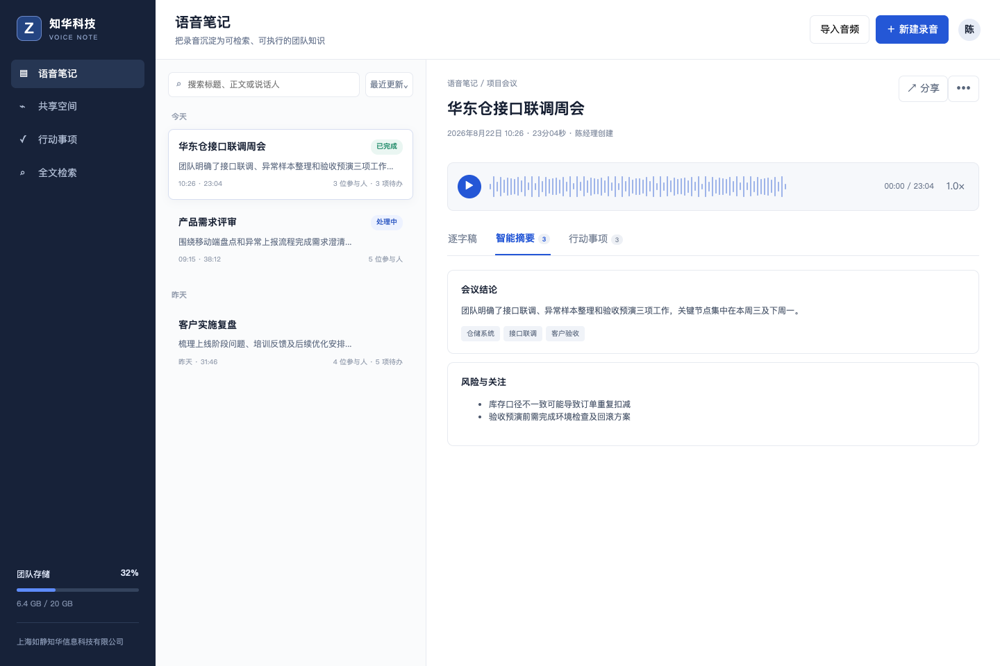

[简体中文](README.md) | **English**

## 2026-10-23: Speaker-aware WebVTT export

This update implements **Speaker-aware WebVTT export** on the backend, with structured input, explicit validation, evidence or exception details, and a responsive utility page at `/practical.html`. Results are computed from submitted data, not fixed demo responses.

The new endpoint is disabled (503) until the administrator sets an independent 32–256 printable ASCII character ZHUATECH_PRACTICAL_TOKEN. Enter it in the utility page; it is kept only in page memory, never embedded in source or browser storage. Use `POST /api/practical/speaker-webvtt-export`. No external model invocation or business posting occurs. See [algorithm, sample, boundaries and test commands](docs/AI_MULTIMODAL_UPGRADE_20261023.md).

# ZhuaTech VoiceNote

> A source-available enterprise project by [ZhuaTech](https://www.zhuatech.cn/) for enterprise AI-assisted workflows with human governance.

ZhuaTech VoiceNote provides a practical, self-hosted foundation for enterprise AI-assisted workflows with human governance. It is designed for business operators, domain reviewers, AI teams, and administrators, with clear business records, controlled workflows, operational visibility, and auditable actions.

This repository is intended for learning, technical evaluation, and non-commercial collaboration. The included implementation, tests, database resources, and container configuration provide a reproducible starting point for further enterprise adaptation.

**Search topics:** enterprise voicenote, self-hosted voicenote, Java Spring Boot enterprise software, digital transformation.

## Enterprise Use

- **Primary users:** Business operators, domain reviewers, AI teams, and administrators.
- **Deployment model:** Self-hosted, with container-based local deployment where supported.
- **Governance baseline:** Role-aware operations, validation, approval boundaries, exception handling, and auditability.
- **Production boundary:** Review security, identity, backup, observability, capacity, and compliance controls before production use.

## Core Capabilities

- **Voice Note** — Manage voice note with ownership, validation, and explicit lifecycle states.
- **Voice Note Segment** — Coordinate voice note segment through controlled workflows and approval gates.
- **Voice Note Action** — Track voice note action metrics, exceptions, deadlines, and follow-up actions.
- **Structured business inputs** — Preserve structured business inputs evidence in searchable, traceable operational history.
- **Rule-based local execution mode** — Expose rule-based local execution mode in role-aware user and administration workspaces.
- **Provider-neutral AI integration interface** — Connect provider-neutral ai integration interface to external systems through configurable integration boundaries.

## Architecture and Runtime

**Technology stack:** Java 21 · Spring Boot · Responsive HTML5 · MySQL 8 · Docker Compose

### Repository Layout

- `backend/` — Java backend, domain services, APIs, validation, and automated tests
- `frontend/` — responsive user and administration interfaces
- `database/` — database schema, migrations, or demonstration data
- `docs/` — architecture, operations, screenshots, and supporting documentation
- `compose.yaml` — local multi-service orchestration

## Quick Start

```bash
docker compose up -d --build
```

- Review `compose.yaml` before changing published ports, storage paths, or production credentials.

## Verification

Run the checks supported by this repository before changing or deploying it:

```bash
cd backend && mvn test
```

## Interface Preview

### Voicenote Workspace



### Voicenote Summary



## Security and Production Readiness

- Never commit real passwords, API keys, tokens, certificates, customer data, or production connection strings.
- Replace all local demonstration credentials and secrets before deployment.
- Apply least privilege, tenant isolation, backup and restore drills, monitoring, rate limiting, and vulnerability management.
- Please report security issues privately through the contact channels below instead of publishing sensitive details.

## Usage and Commercial Licensing

Copyright © 2026 Shanghai Rujing Zhihua Information Technology Co., Ltd.

This project is a publicly available source edition intended solely for personal learning, technical research, and non-commercial communication. Commercial use, paid delivery, resale, hosted commercial services, and commercial derivative distribution require prior written authorization from the copyright holder.

Third-party dependencies remain subject to their respective licenses. Review the repository `LICENSE` and `NOTICE` files before use.

## Commercial Licensing and Enterprise Services

For commercial licensing, private deployment, enterprise customization, software outsourcing, implementation services, FDE outsourcing, OPC technical support, or AI transformation consulting, contact ZhuaTech:

- Email: [han@zhuatech.cn](mailto:han@zhuatech.cn)
- Email: [jack@zhuatech.cn](mailto:jack@zhuatech.cn)
- [WhatsApp: +86 17521234993](https://wa.me/8617521234993)
- Website: [https://www.zhuatech.cn/](https://www.zhuatech.cn/)

## About ZhuaTech

[ZhuaTech](https://www.zhuatech.cn/) is operated by Shanghai Rujing Zhihua Information Technology Co., Ltd. We support small and medium-sized enterprises with digital transformation, AI adoption, enterprise software implementation, custom development, software project outsourcing, FDE services, OPC integration, and long-term technical support.
